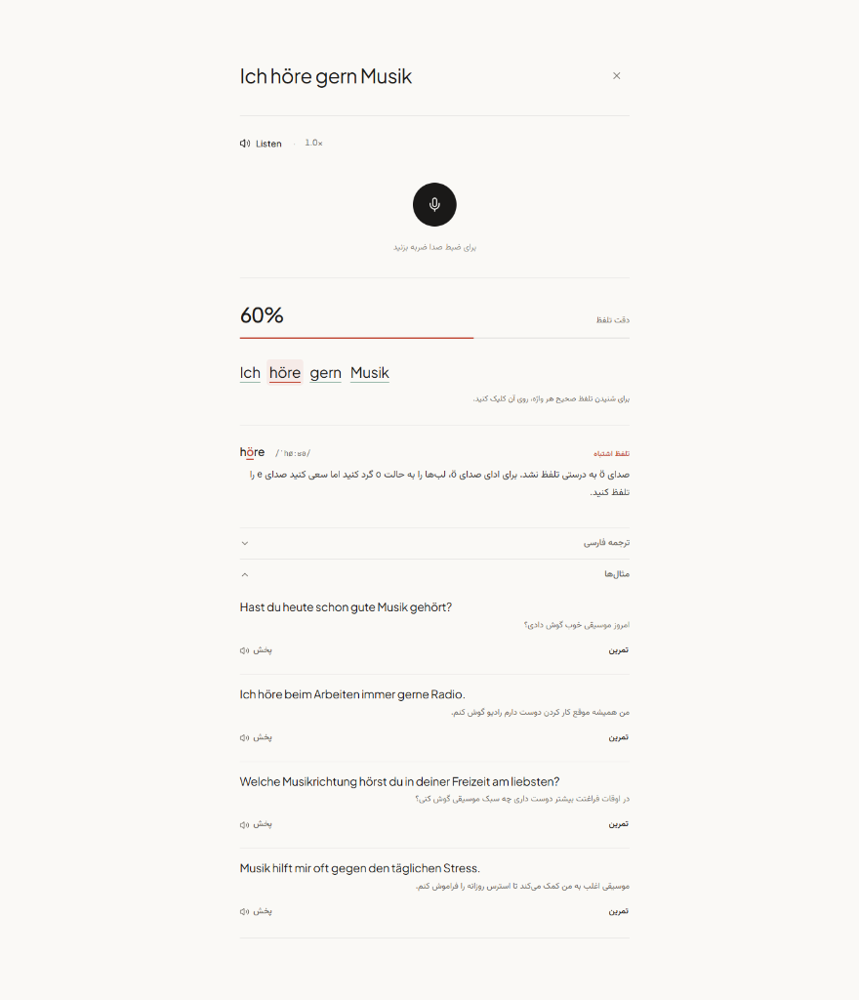
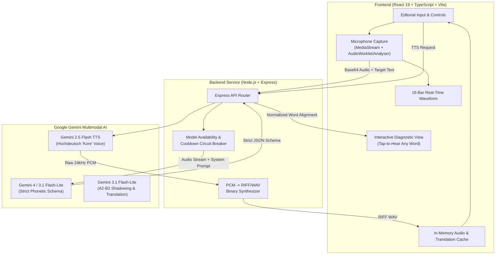

# Laut — AI-Powered German Phonetics & Pronunciation Coach

<p align="center">
  
</p>

<p align="center">
  <strong>An intelligent Standard German (Hochdeutsch) pronunciation coach, acoustic phonetic evaluator, dictionary, and sentence-level shadowing laboratory crafted specifically for Persian speakers.</strong>
</p>

<p align="center">
  <a href="https://github.com/sepehr-safaeian/Laut/stargazers"></a>
  <a href="https://github.com/sepehr-safaeian/Laut/network/members"></a>
  <a href="https://github.com/sepehr-safaeian/Laut/blob/main/LICENSE"></a>
  <a href="https://react.dev/"></a>
  <a href="https://www.typescriptlang.org/"></a>
  <a href="https://tailwindcss.com/"></a>
  <a href="https://ai.google.dev/"></a>
  <a href="https://vite.dev/"></a>
</p>

---

## 💡 The Story & Motivation

> *"Language is acoustic architecture. For Persian speakers learning German, the bottleneck isn't grammar or vocabulary—it's the muscle memory of unfamiliar phonemes."*

When learning Standard German (*Hochdeutsch*), native Persian speakers constantly encounter a specific set of phonological traps:
- **Umlauts** (`ä`, `ö`, `ü`) collapsing into standard back vowels (`a`, `o`, `u`).
- **Palatal vs. Velar Fricatives**: The *ich-Laut* `[ç]` (soft palate) conflated with the *ach-Laut* `[x]` (Persian **«خ»**) or postalveolar *sch* `[ʃ]` (Persian **«ش»**).
- **Consonant Onsets**: Initial `sp-` and `st-` (`[ʃp]`, `[ʃt]`) burdened with epenthetic vowels (e.g. *«اسـ»*).
- **Affricates & Voicing**: German `z` `[ts]` mispronounced as voiced `[z]`, and English `w` `[w]` invading German `w` `[v]`.
- **Auslautverhärtung**: Final devoicing of plosives (`b`→`p`, `d`→`t`, `g`→`k`) and vocalized/uvular `r` (`[ʁ]` / `[ɐ]`).

**Laut** was created initially as my **personal daily study assistant and speech laboratory** to master German pronunciation. Existing language apps only evaluate speech via broad Speech-to-Text (STT) transcription matching—they tell you *if* you said a word, but never *how acoustically authentic* your tongue, lip, and vocal cord positions were. 

**Laut solves this:** It captures real microphone audio, streams it to multimodal Gemini models trained on phonetics, performs strict acoustic analysis against German phonology, and outputs **actionable mouth-position coaching in Persian**, pinpointed down to the exact offending letter.

---

## ✨ Key Features

### 🎙️ 1. True Acoustic Phonetic Evaluation (Not Just STT)
- Evaluates actual acoustic waveforms rather than comparing text transcripts.
- Strict grading across four categorical states per word:
  - `accurate`: Native or near-native standard Hochdeutsch articulation.
  - `imprecise`: Intelligible, with minor vowel length, tenseness, or stress deviation.
  - `mispronounced`: Clear phonemic error (e.g., missing umlaut, wrong fricative, wrong consonant onset).
  - `omitted`: Missing word or swallowed critical syllable.

### 🎯 2. Substring-Level Error Pinpointing & Persian Articulation Tips
- Instead of just marking `"Brötchen"` wrong, Laut isolates the exact offending character sequence (`"ö"`) and returns immediate, actionable Persian feedback:
  > *«لب‌ها را مانند تلفظ حرف [o] کاملاً گرد کنید اما هم‌زمان تلاش کنید صدای [e] را از گلو ادا نمایید.»*
- IPA phonetic target annotations provided for every flagged error (e.g., `/ˈbʁøːtçən/`).

### 🔊 3. Dual-Tier Native Speech Engine & Binary WAV Synthesis
- **Tier 1 (Gemini Studio TTS):** Generates natural Hochdeutsch audio via `gemini-2.5-flash-preview-tts` (Kore voice).
- **Custom RIFF WAV Synthesizer:** Includes a custom 44-byte binary RIFF constructor to transform raw 24kHz 16-bit mono PCM into universally playable WAV buffers in memory.
- **Tier 2 (Browser Web Speech API Fallback):** Auto-detects installed German neural voices (`de-DE`) with zero downtime if remote services are unavailable.
- **In-Memory Audio Caching:** Instant, zero-latency replay for repeated drills.
- **Variable Playback Speed:** Toggle between `1.0×` and `0.75×` speed with strict pitch preservation (`preservesPitch: true`).

### 📊 4. Real-Time Web Audio API Waveform Visualizer
- Powered by `AudioContext` and `AnalyserNode`.
- Computes RMS energy levels across 16 responsive bars at 60 FPS while recording.
- Automatic silence, empty recording, and micro-duration threshold checks.

### 🔄 5. Contextual A2–B2 Shadowing & Sentence Drills
- Dynamically generates 3 to 4 related German sentences matching the user's vocabulary and level.
- Complete with idiomatic Persian translations.
- One-click **"تمرین این جمله" (Practice this sentence)** loads any example directly into the speech lab for shadowing.

### 📖 6. Editorial Minimalist Aesthetic
- Crafted with an understated, editorial warm palette inspired by traditional print typography:
  - Canvas: `#FAF9F6`, Surface: `#F2EFE9`, Deep Ink: `#1A1918`
  - Feedback accents: Sage `#2E6F56`, Amber `#B4732A`, Terracotta `#C24D3A`
- Built with **Tailwind CSS v4** and fluid RTL/LTR typographic layout using **Vazirmatn** and **Plus Jakarta Sans**.

---

## 🏗️ System Architecture



---

## 🧠 Engineering Highlights & Technical Challenges

### 1. Low-Level PCM to RIFF/WAV Synthesis
Gemini's audio generation returns raw 24kHz 16-bit mono PCM chunks (`audio/pcm`). Standard HTML5 `<audio>` elements cannot play raw PCM without an audio container header. 

Rather than pulling heavy third-party transcoding libraries, Laut implements a lightweight pure TypeScript binary encoder ([`src/utils/audioWav.ts`](src/utils/audioWav.ts)):

```typescript
export function wrapPcmAsWav(
  pcmData: Uint8Array,
  sampleRate = 24000,
  numChannels = 1,
  bitsPerSample = 16,
): Uint8Array {
  const byteRate = (sampleRate * numChannels * bitsPerSample) / 8;
  const blockAlign = (numChannels * bitsPerSample) / 8;
  const dataSize = pcmData.byteLength;
  const wav = new Uint8Array(44 + dataSize);
  const view = new DataView(wav.buffer);

  wav.set([0x52, 0x49, 0x46, 0x46], 0); // "RIFF"
  view.setUint32(4, 36 + dataSize, true);
  wav.set([0x57, 0x41, 0x56, 0x45], 8); // "WAVE"
  wav.set([0x66, 0x6d, 0x74, 0x20], 12); // "fmt "
  view.setUint32(16, 16, true);          // Subchunk1Size (PCM = 16)
  view.setUint16(20, 1, true);           // AudioFormat (PCM = 1)
  view.setUint16(22, numChannels, true);
  view.setUint32(24, sampleRate, true);
  view.setUint32(28, byteRate, true);
  view.setUint16(32, blockAlign, true);
  view.setUint16(34, bitsPerSample, true);
  wav.set([0x64, 0x61, 0x74, 0x61], 36); // "data"
  view.setUint32(40, dataSize, true);
  wav.set(pcmData, 44);

  return wav;
}
```

### 2. Resilient Dual-Model Fallback & Cooldown Circuit Breaker
Free-tier AI APIs are prone to rate limits (HTTP 429) and transient spikes. Laut features an autonomous availability scheduler ([`server.ts`](server.ts)):
- Dynamic tracking of model cooldown timers (`modelCooldownUntil`).
- Instant automatic fallback (e.g., `gemini-4-hydrogen` ➔ `gemini-3.1-flash-lite`).
- Exponential backoff with retry guards to prevent cascade failures.

### 3. Punctuation-Preserving Sliding Window Alignment
LLMs frequently strip punctuation or alter word boundaries when returning structured diagnostic arrays. Laut's alignment engine ([`src/utils/pronunciation.ts`](src/utils/pronunciation.ts)) executes a sliding window token-matching algorithm against the raw user input:
- Retains German capitalization and umlauts (`ä`, `ö`, `ü`, `ß`).
- Preserves surrounding German quotes (`„...“`) and punctuation.
- Accurately aligns status tags (`accurate`, `imprecise`, `mispronounced`, `omitted`) even when words are skipped during speech.

---

## 📂 Repository Structure

```text
Laut/
├── src/
│   ├── components/
│   │   ├── AudioControls.tsx       # Mic trigger, speed toggle (1x/0.75x), and live waveform
│   │   ├── DiagnosticView.tsx      # Interactive sentence markup, score bar & phonetic cards
│   │   ├── EditorialInput.tsx      # Auto-expanding German editorial text input
│   │   └── StudyAccordions.tsx     # Contextual A2-B2 shadowing examples & Persian translation
│   ├── hooks/
│   │   ├── useAudioRecorder.ts     # Web Audio API AnalyserNode & MediaRecorder lifecycle
│   │   └── useGermanSpeech.ts      # Gemini TTS + Web Speech API fallback & in-memory cache
│   ├── types/
│   │   └── pronunciation.ts        # TypeScript schemas & diagnostic domain types
│   ├── utils/
│   │   ├── audioWav.ts             # Binary RIFF/WAVE header synthesis from PCM
│   │   ├── pronunciation.ts        # Tokenizer, string-diff highlighter & normalizers
│   │   ├── pronunciation.test.ts   # Unit test suite for phonetic utilities
│   │   └── studyHelpers.ts         # Example sentence normalizers & curated drills
│   ├── App.tsx                     # Main application orchestrator
│   ├── index.css                   # Tailwind CSS v4 design tokens & typography
│   └── main.tsx                    # React root entry point
├── .env.example                    # Environment variable template
├── index.html                      # HTML5 template with Vazirmatn & Plus Jakarta Sans
├── package.json                    # Dependencies & build scripts
├── server.ts                       # Express backend, Gemini SDK client & Vite middleware
├── tsconfig.json                   # Strict TypeScript compiler configuration
└── vite.config.ts                  # Vite bundler configuration
```

---

## 🚀 Getting Started

### Prerequisites
- **Node.js**: `v20.x` or later (tested on Node v24).
- **Gemini API Key**: Obtain a free key from [Google AI Studio](https://aistudio.google.com/).

### 1. Clone the Repository
```bash
git clone https://github.com/sepehr-safaeian/Laut.git
cd Laut
```

### 2. Install Dependencies
```bash
npm install
# or
bun install
```

### 3. Configure Environment Variables
Create a `.env` file in the project root:
```bash
cp .env.example .env
```
Fill in your Google Gemini API Key:
```env
GEMINI_API_KEY="your-gemini-api-key-here"
PORT=3000
NODE_ENV="development"
```

### 4. Run the Development Server
```bash
npm run dev
```
Open [http://localhost:3000](http://localhost:3000) in your browser.

### 5. Run Tests & Type Checks
```bash
# Run unit tests
npm test

# Run TypeScript type check
npm run lint
```

### 6. Production Build
```bash
npm run build
npm start
```

---

## 🧪 Testing Coverage

The project includes unit tests verifying phonetic and audio integrity:
- **German Tokenization**: Handling of umlauts, punctuation, and German typography (`„...“`, `Straße`, `U-Bahn`).
- **Sliding-Window Alignment**: Correct identification of omitted words and preservation of capitalization.
- **Problem Substring Isolation**: Digraph and umlaut extraction (`ch`, `ö`, `sch`, `sp`).
- **Binary Audio Guard**: Validates 44-byte RIFF header synthesis and sample rate parsing.

Run the test suite via Node's native test runner:
```bash
npm test
```

---

## 🛣️ Roadmap

- [ ] **Phoneme Waveform Spectrogram**: Visual comparison between learner's audio spectrogram and native reference.
- [ ] **Custom Word Lists & Anki Export**: Export tricky words with phonetic coaching notes directly to Anki deck format.
- [ ] **Offline PWA Support**: Progressive Web App caching with local speech-synthesis fallback.
- [ ] **Dialect Toggles**: Expand phonetic coaching to Austrian (*Österreichisches Deutsch*) and Swiss (*Schwiizerdütsch*) standard variations.

---

## 👨‍💻 Author

**Sepehr Safaeian**
- GitHub: [@sepehr-safaeian](https://github.com/sepehr-safaeian)
- Project Repository: [Laut on GitHub](https://github.com/sepehr-safaeian/Laut)

---

## 📄 License

This project is licensed under the [MIT License](LICENSE).
Feel free to use, modify, and contribute!
